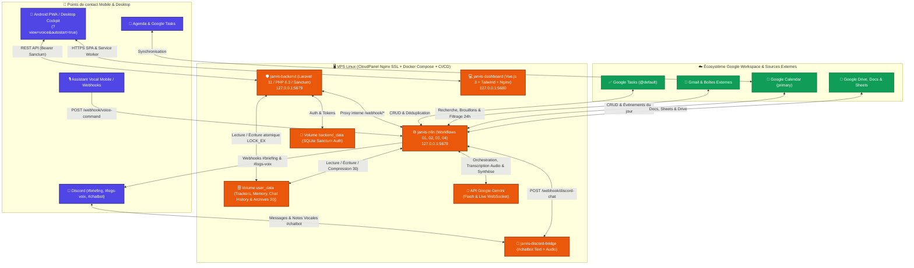

# Jarvis Assistant — Event-Driven AI Orchestrator & Schema-less Personal Cockpit

> **Plateforme d'orchestration IA auto-hébergée, extensible à chaud par commandes vocales et textuelles (*Schema-less Dynamic Trackers Engine*), combinant workflows événementiels (`n8n`), passerelle REST (`Laravel 11`) et cockpit Web/PWA (`Vue.js 3` avec thème Pastel & Crème / Graphite).**

[](.github/workflows/deploy.yml)
[](workflows/)
[](backend/)
[](frontend/)
[](workflows/)

---

## 1. Pitch & Proposition de valeur

Les outils de productivité classiques imposent des schémas rigides (bases de données figées, formulaires complexes) qui multiplient la friction au quotidien. À l'inverse, les assistants vocaux grand public manquent de mémoire contextuelle durable et d'intégration profonde avec les flux de travail d'un développeur.

**Jarvis Assistant** résout ce compromis grâce à une architecture **100 % générique et pilotée par schémas dynamiques** :
- **Zéro schéma codé en dur :** L'utilisateur crée, modifie et interroge ses propres outils de suivi (cycles récurrents, tables de suivi/CRM, journaux d'activité) et ses règles métier **directement à la voix ou par message**, sans jamais modifier le code source ni redéployer l'application.
- **Interaction en moins de 2 minutes :** Agrégation proactive multi-sources (Google Calendar, Gmail, Google Tasks, Drive/Docs/Sheets), briefings matinaux automatisés sur Discord, et cockpit Web/PWA mobile avec mode vocal temps réel (*barge-in*).
- **Confidentialité & Reproductibilité Open-Source :** Le moteur public est intégralement découplé des données d'exécution privées (`user_data/`), permettant à n'importe quel développeur d'auto-héberger sa propre instance sur un simple VPS Linux.

👉 **[Consulter l'étude d'architecture complète (`docs/ARCHITECTURE_DEEP_DIVE.md`)](docs/ARCHITECTURE_DEEP_DIVE.md)**

---

## 2. Points forts d'ingénierie (Architecture Highlights)

### A. Moteur de Trackers Dynamiques Sans Schéma Figé (*Schema-less Meta-Tools*)
Plutôt que de créer une table SQL par cas d'usage, l'agent IA dispose de **4 méta-outils universels** (`create_or_update_tracker_schema`, `mutate_tracker_record`, `query_tracker_records`, `update_memory_rule`) opérant sur un volume JSON isolé (`user_data/`) :
- **`CYCLE_STATE_MACHINE`** : Machines à états cycliques (ex. rotation d'entraînement sportif, programme de révision) avec avancement idempotent et report sans perte d'état (*skip* générant une règle volatile d'expiration automatique).
- **`COLLECTION_TABLE`** : Tables structurées à typage dynamique (ex. CRM freelance, suivi de candidatures, devis) avec filtrage et préservation des entrées actives lors des archivages.
- **`ACTIVITY_LOG`** : Journaux horodatés (ex. sessions de veille, heures de pratique, lectures) compressés mensuellement par LLM au-delà de 30 jours (`archive_<id>.json`).

### B. Passerelle API REST Low-RAM (`Laravel 11` + `Sanctum` + `SQLite`)
- **Empreinte mémoire optimisée (< 80 Mo RAM au repos) :** Conteneur Alpine combinant **PHP 8.3-FPM (`pm = ondemand`)**, **Nginx** et **SQLite** (authentification **Laravel Sanctum** sans serveur SGBD lourd).
- **Concurrence fichier inter-conteneurs :** Partage du volume `user_data` sous UID/GID `1000:1000` entre `jarvis-n8n` et `jarvis-backend` avec écritures atomiques (`LOCK_EX`) et validation stricte `snake_case` anti-*path traversal*.
- **Pont interne vers n8n :** Délégation sécurisée des commandes vocales, du déclenchement de briefing et des messages de chat sur le réseau Docker interne (`http://jarvis-n8n:5678/webhook/...`).

### C. Cockpit Web & PWA Mobile Auto-Générée (`Vue.js 3` + `Tailwind CSS` + `Shadow DOM`)
- **Rendu UI 100 % Schema-Driven & Vues Personnalisées Générées par l'Agent (Shadow DOM) :** L'écran d'accueil s'ouvre directement sur les trackers dynamiques générés depuis `trackers_registry.json`. Chaque tracker peut utiliser la vue standard ou une **vue HTML/CSS sur-mesure générée à la voix par l'agent** (`update_tracker_custom_view`), isolée dans un **Shadow DOM** sécurisé (sanitization serveur & client anti-XSS, templating temps réel `{{current_step}}` / `{{#each records}}` et boutons déclaratifs `data-jarvis-action`).
- **Double Thème Pastel & Crème (Light) / Graphite (Dark) :** Bascule instantanée dans le header avec persistance `localStorage`, héritage automatique des variables CSS dans le Shadow DOM et mise à jour dynamique de la barre de statut PWA Android (`theme-color`).
- **Mode Vocal Épuré & Raccourci PWA 1-Tap (`/?view=voice&autostart=true`) :** Dictée vocale directe sans historique lourd en mémoire, affichage de la réponse formatée en Markdown et nettoyage automatique de la syntaxe Markdown avant lecture vocale TTS (`speechSynthesis`).

### D. DevOps, CI/CD & *Agentic Context Engineering*
- **Isolation Réseau & SSL :** Les 3 services exposés (`jarvis-n8n`, `jarvis-backend`, `jarvis-dashboard`) écoutent exclusivement sur l'interface loopback `127.0.0.1` (`5678`, `5679`, `5680`) derrière un Reverse Proxy Nginx/CloudPanel avec terminaison SSL Let's Encrypt.
- **Déploiement Continu (GitHub Actions SSH) :** Chaque `push` sur `main` met à jour les conteneurs, exécute les migrations SQLite, résout dynamiquement les identifiants de credentials n8n et réimporte les workflows JSON versionnés.
- **Gouvernance IA & Sécurité Déterministe :** Spécifications modulaires dans `.agents/skills/` et hook de pré-commit `.agents/hooks/pre-commit-secrets.sh` bloquant toute clé API ou donnée personnelle avant chaque commit.

---

## 3. Schéma d'Architecture Global

> Source du diagramme : [`docs/achitecture.mmd`](docs/achitecture.mmd)



---

## 4. Stack Technique & Arborescence du Monorepo

| Couche | Technologies | Rôle |
| :--- | :--- | :--- |
| **Orchestration IA** | `n8n` (Docker), `JavaScript (Node.js)` | Exécution des 4 workflows événementiels, connecteurs OAuth2 Google Workspace et méta-outils JSON |
| **Modèles LLM & Voix** | `Gemini Flash`, `Gemini 2.5 Flash Native Audio (Live API)` | Function calling structuré, synthèse matinale, compression mémoire 30j et streaming vocal WebSocket |
| **API Gateway** | `PHP 8.3-FPM (ondemand)`, `Laravel 11`, `Sanctum`, `SQLite`, `PHPUnit` | Authentification Bearer, CRUD atomique `LOCK_EX` sur `user_data/`, proxy n8n et sessions éphémères Gemini Live |
| **Cockpit & PWA** | `Vue.js 3 (<script setup>)`, `Vite 6`, `Tailwind CSS`, `WebAudio API` | Interface responsive pilotée par schémas, télémétrie LLMOps, client WebSocket PCM 16/24 kHz et Service Worker PWA |
| **Passerelle Discord** | `Node.js 20 Alpine`, `discord.js v14` | Écoute temps réel du salon `#chatbot` (texte + notes vocales `.ogg`/`.mp3`/`.m4a`) vers n8n |
| **Infra & CI/CD** | `Docker Compose`, `Nginx Alpine`, `CloudPanel SSL`, `GitHub Actions` | Conteneurisation isolée (`1000:1000`), reverse proxy local `127.0.0.1` et déploiement SSH automatisé |

```text
├── .agents/
│   ├── hooks/pre-commit-secrets.sh          # Hook déterministe anti-secrets & validation syntaxique JSON
│   └── skills/                              # Spécifications d'architecture & garde-fous UX (Dual-Loop Workflow)
├── .github/workflows/deploy.yml             # Pipeline CI/CD SSH (build Docker, migrations Laravel, import n8n)
├── backend/                                 # API Gateway Laravel 11 (Controllers, Services, Sanctum, Tests PHPUnit)
├── docs/
│   ├── achitecture.mmd                      # Source Mermaid du schéma d'architecture
│   └── ARCHITECTURE_DEEP_DIVE.md            # Documentation technique exhaustive & étude de cas portfolio
├── frontend/                                # Cockpit Vue.js 3 + Tailwind CSS + PWA Mobile & WebAudio Live
├── infra/
│   ├── docker-compose.yml                   # Définition des 4 conteneurs de production (n8n, bridge, backend, dashboard)
│   └── .env.exemple                         # Modèle de variables d'environnement sanitisé
├── scripts/discord-bridge/                  # Micro-service Node.js discord.js v14 (Texte & Audio -> n8n)
└── workflows/                               # Workflows n8n versionnés et sanitisés
    ├── 01-voice-agent-core.json             # Agent principal (4 Méta-Outils + 17 outils Google Workspace)
    ├── 02-morning-briefing.json             # Briefing matinal 08:30 (Agenda, Mails 24h, Tasks, Mutations Trackers)
    ├── 03-memory-compression.json           # Compression mensuelle des journaux > 30j & purge des règles expirées
    └── 04-discord-chatbot.json              # Chatbot persistant multi-tours (Texte + Transcription Audio)
```

---

## 5. Installation Rapide (Self-Hosting Quick Start)

### Prérequis
- Docker & Docker Compose v2
- Un nom de domaine (ou sous-domaines) pointant vers un Reverse Proxy local (`127.0.0.1:5678`, `127.0.0.1:5679`, `127.0.0.1:5680`)
- Une clé API Google Gemini (`GEMINI_API_KEY`)

### Déploiement en 4 commandes

```bash
# 1. Cloner le dépôt et préparer les variables d'environnement
git clone https://github.com/vicoescobar/jarvis-assistant.git
cd jarvis-assistant
cp infra/.env.exemple .env

# 2. Initialiser les volumes persistants avec l'UID 1000:1000 (partagé entre n8n et Laravel)
mkdir -p infra/n8n_data infra/user_data infra/backend_data
echo '{"trackers":{}}' > infra/user_data/trackers_registry.json
echo '{"morning_rules":[],"custom_scopes":{}}' > infra/user_data/memory_rules.json
echo '{"messages":[]}' > infra/user_data/discord_chat_history.json
touch infra/backend_data/database.sqlite
sudo chown -R 1000:1000 infra/n8n_data infra/user_data infra/backend_data

# 3. Démarrer la stack complète et initialiser la base d'authentification Sanctum
docker compose --env-file .env -f infra/docker-compose.yml up -d --build
docker exec jarvis-backend php artisan migrate --force
docker exec jarvis-backend php artisan jarvis:seed-owner

# 4. Importer et activer les workflows dans n8n
docker exec -u node jarvis-n8n n8n import:workflow --separate --input=/home/node/workflows/
docker exec -u node jarvis-n8n n8n update:workflow --all --active=true
```

### Vérification des tests & de la sécurité avant commit
```bash
# Exécuter la suite de tests Feature PHPUnit (API Gateway, Trackers, Mémoire, Gemini Live)
cd backend && php artisan test

# Vérifier l'absence de secrets et la validité JSON des workflows n8n
./.agents/hooks/pre-commit-secrets.sh
```

---

## 6. Documentation Technique Approfondie

Pour explorer en détail les contrats de données JSON (`user_data/`), le fonctionnement interne des 4 méta-outils, le pipeline audio PCM 16/24 kHz de Gemini Live, la gestion de la concurrence `LOCK_EX` et la fiche synthèse d'ingénierie :

📖 **[Lire `docs/ARCHITECTURE_DEEP_DIVE.md` — Architecture Deep Dive & Portfolio Case Study](docs/ARCHITECTURE_DEEP_DIVE.md)**
