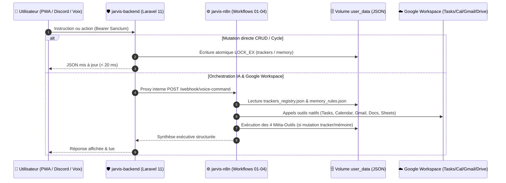
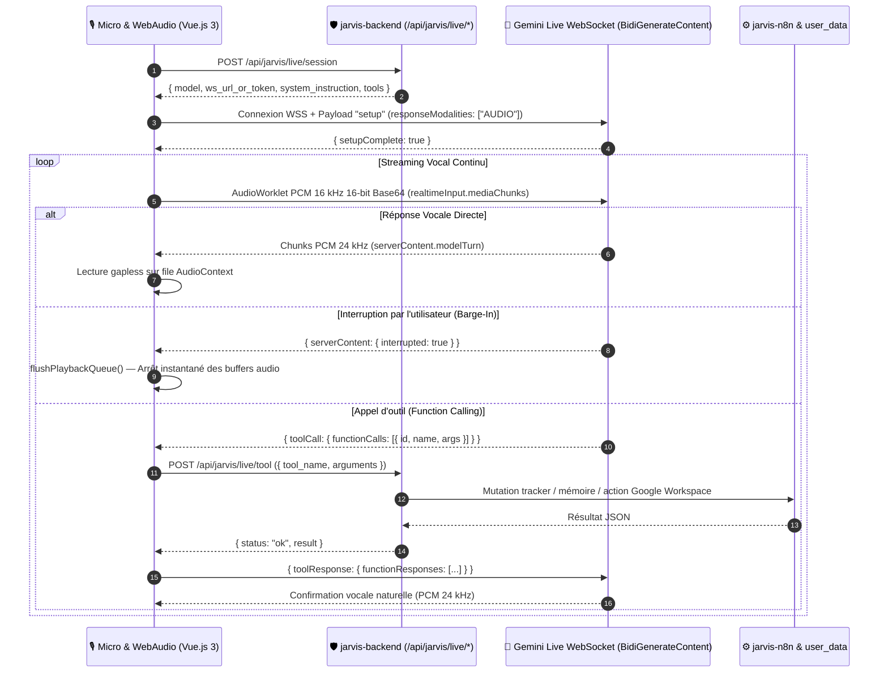

# Jarvis Assistant — Architecture Deep Dive & Engineering Case Study

Ce document constitue la référence d'architecture complète du monorepo **Jarvis Assistant**. Il détaille les choix d'ingénierie, les flux de données inter-conteneurs, les contrats JSON du moteur de trackers dynamiques, l'intégration WebAudio temps réel avec la **Gemini Multimodal Live API** et les mécanismes de sécurité DevOps.

> **Confidentialité & Reproductibilité :** Conformément à l'architecture *open-source* du projet, tous les schémas et scénarios présentés dans ce document utilisent des **exemples génériques et neutres** (suivi de routine sportive, CRM freelance générique, veille académique/technique, gestion de sessions créatives). Aucune donnée personnelle n'est stockée dans le code source.

---

## Table des matières
1. [Genèse, Problématique & Philosophie d'Ingénierie](#1-genèse-problématique--philosophie-dingénierie)
2. [Architecture Système Détaillée (Couche par Couche)](#2-architecture-système-détaillée-couche-par-couche)
   - [2.1 Couche Infrastructure, Réseau & CI/CD](#21-couche-infrastructure-réseau--cicd)
   - [2.2 Couche Orchestration IA (`n8n` + `Gemini Flash`)](#22-couche-orchestration-ia-n8n--gemini-flash)
   - [2.3 Couche Passerelle REST & Sessions Éphémères (`Laravel 11`)](#23-couche-passerelle-rest--sessions-éphémères-laravel-11)
   - [2.4 Couche Cockpit Web, PWA Mobile & Audio Temps Réel (`Vue.js 3`)](#24-couche-cockpit-web-pwa-mobile--audio-temps-réel-vuejs-3)
3. [Contrats de Données (`user_data/` JSON Schemas)](#3-contrats-de-données-user_data-json-schemas)
4. [Catalogue des Capacités & Cas d'Usage Génériques](#4-catalogue-des-capacités--cas-dusage-génériques)
5. [Sécurité, Gouvernance IA & Hygiène Open-Source](#5-sécurité-gouvernance-ia--hygiène-open-source)
6. [Fiche Synthèse Portfolio (Case Study Summary)](#6-fiche-synthèse-portfolio-case-study-summary)

---

## 1. Genèse, Problématique & Philosophie d'Ingénierie

### 1.1 Le problème des systèmes de productivité rigides
La majorité des tableaux de bord personnels ou d'entreprise échouent sur deux points :
1. **Rigidité structurelle :** Ajouter un nouveau besoin métier (par exemple suivre un pipeline de devis clients ou une rotation d'entraînement cyclique) exige habituellement de modifier le schéma de base de données (migrations SQL), d'écrire de nouveaux endpoints backend et de développer des composants frontend dédiés.
2. **Coût cognitif d'interaction :** L'utilisateur doit ouvrir une interface complexe, naviguer dans plusieurs menus et saisir manuellement chaque champ. Au-delà de 2 minutes de friction quotidienne, le taux d'abandon explose.

### 1.2 Approche retenue : *Event-Driven* + *Schema-less Meta-Tools*
Jarvis inverse ce paradigme autour de quatre principes d'ingénierie :
- **Proactivité au point de performance :** Plutôt que d'attendre que l'utilisateur consulte un tableau de bord passif, le système agrège les sources externes (agenda, boîtes mail, liste de tâches, trackers actifs) et pousse un briefing exécutif structuré en 5 sections chaque matin à `08:30`.
- **Extensibilité à chaud sans code (*Zero-Code Runtime Schema Mutation*) :** L'intelligence artificielle ne se contente pas de répondre à des questions ; elle possède des **méta-outils** capables de créer de nouveaux schémas de trackers dans `trackers_registry.json` et d'adapter immédiatement l'interface Vue.js 3 qui se reconstruit à partir de ce registre.
- **Sobriété des ressources sur VPS mutualisé (4 Go RAM) :** Au lieu de multiplier les bases de données (PostgreSQL, Redis, MongoDB) qui satureraient la mémoire vive, Jarvis combine un stockage JSON atomique (`LOCK_EX`) pour les trackers dynamiques et une base **SQLite** embarquée pour l'authentification **Laravel Sanctum**, maintenant l'empreinte RAM de la passerelle API et du dashboard sous la barre des **100 Mo au repos**.
- **Sobriété éditoriale & Ton exécutif :** Les prompts système et l'interface utilisateur appliquent un ton direct, factuel et synthétique (*Chief-of-Staff*), dépourvu de mécaniques punitives (aucun compteur de *streaks* brisés, aucun badge d'alerte anxiogène, aucune suppression automatique des tâches non terminées la nuit).

---

## 2. Architecture Système Détaillée (Couche par Couche)

### 2.1 Couche Infrastructure, Réseau & CI/CD

#### A. Topologie Docker Compose & Isolation Réseau (`127.0.0.1`)
L'ensemble de la stack s'exécute sur un VPS Linux Ubuntu via 4 conteneurs définis dans [`infra/docker-compose.yml`](../infra/docker-compose.yml) :

| Service Docker | Image / Base | Binding Hôte | Rôle |
| :--- | :--- | :--- | :--- |
| `jarvis-n8n` | `docker.n8n.io/n8nio/n8n:latest` | `127.0.0.1:5678:5678` | Moteur de workflows événementiels & agents IA |
| `jarvis-backend` | `php:8.3-fpm-alpine` + `nginx` | `127.0.0.1:5679:8080` | API Gateway Laravel 11, Auth Sanctum & Bridge Gemini Live |
| `jarvis-dashboard` | `node:22-alpine` -> `nginx:1.27-alpine` | `127.0.0.1:5680:80` | Cockpit Web Vue.js 3 & PWA Mobile |
| `jarvis-discord-bridge` | `node:20-alpine` (`discord.js v14`) | Réseau Docker interne uniquement | Passerelle WebSocket Discord Gateway (`#chatbot`) -> n8n |

**Sécurité réseau :** Aucun port Docker n'est exposé sur `0.0.0.0`. Tous les conteneurs écoutent strictement sur `127.0.0.1`. Le serveur hôte utilise **CloudPanel (Nginx)** en frontal pour gérer la terminaison SSL/TLS (Let's Encrypt) et router chaque sous-domaine vers le port loopback correspondant.

#### B. Partage de Volume & Concurrence Fichier (`UID 1000:1000` + `LOCK_EX`)
Les conteneurs `jarvis-n8n` (utilisateur interne `node`, UID `1000`) et `jarvis-backend` (utilisateur `www-data` remappé sur UID/GID `1000:1000` dans [`backend/Dockerfile`](../backend/Dockerfile)) montent le même volume hôte `./user_data` :
- Dans `jarvis-n8n` : `/home/node/user_data`
- Dans `jarvis-backend` : `/var/www/user_data`

Pour éviter toute corruption JSON lors d'accès simultanés (ex. le cron matinal n8n qui écrit pendant que l'utilisateur modifie un tracker depuis l'application mobile), l'API Laravel effectue toutes ses écritures avec le verrou exclusif `file_put_contents($path, $json, LOCK_EX)` et valide strictement chaque identifiant de tracker via l'expression régulière `/^[a-z0-9_]+$/` (protection contre les attaques par *Path Traversal*).

#### C. Pipeline CI/CD Automatisé (`.github/workflows/deploy.yml`)
À chaque `git push origin main`, GitHub Actions se connecte en SSH avec un utilisateur système dédié et restreint (`jarvis`) et exécute une séquence idempotente :
1. Récupération du code (`git pull origin main`).
2. Création et vérification des fichiers JSON initiaux dans `infra/user_data/` et du fichier `database.sqlite` dans `infra/backend_data/`.
3. Auto-génération de `BACKEND_APP_KEY` (`openssl rand -base64 32`) dans `.env` si absente.
4. Application des permissions `1000:1000` sur les volumes persistants.
5. Reconstruction des conteneurs (`docker compose up -d --build --remove-orphans`).
6. Exécution des migrations SQLite (`php artisan migrate --force`) et synchronisation du compte propriétaire (`php artisan jarvis:seed-owner`).
7. **Résolution dynamique des credentials n8n :** Un script Node.js exporte la table des identifiants OAuth2 actifs de l'instance n8n, réassocie automatiquement les IDs de credentials aux nœuds des fichiers `workflows/*.json`, puis les importe et les active sans coupure de service.

---

### 2.2 Couche Orchestration IA (`n8n` + `Gemini Flash`)

La logique agentique asynchrone repose sur **4 workflows n8n versionnés** dans [`workflows/`](../workflows/) :



#### Workflow 01 — `01-voice-agent-core.json` (`POST /webhook/voice-command`)
Cœur opérationnel de Jarvis. Avant d'invoquer l'agent Gemini Flash, un nœud de pré-traitement lit `trackers_registry.json` et `memory_rules.json` sur le disque et les injecte dans le prompt système avec l'horodatage exact (`Europe/Paris`). L'agent dispose de **21 outils** :
- **Les 4 Méta-Outils universels (Code Tools JavaScript accédant à `/home/node/user_data/`) :**
  1. `create_or_update_tracker_schema` : Crée ou met à jour la définition d'un tracker (`CYCLE_STATE_MACHINE`, `COLLECTION_TABLE`, `ACTIVITY_LOG`) dans `trackers_registry.json` et initialise `data_<tracker_id>.json`.
  2. `mutate_tracker_record` : Insère, met à jour ou supprime une entrée dans `data_<tracker_id>.json`, ou fait évoluer l'index `current_index` d'un cycle (`advance`, `skip_or_shift_cycle` avec `defaultDelta = 0`, `reset`).
  3. `query_tracker_records` : Interroge et filtre les entrées d'un tracker par statut, ancienneté ou plage de dates.
  4. `update_memory_rule` : Ajoute, modifie ou supprime une règle dans `morning_rules` ou dans un scope dynamique `custom_scopes.<scope>` avec support des règles temporaires (`volatile: true`, `expires_at: "YYYY-MM-DD"`).
- **17 Outils Natifs Google Workspace :**
  - **Google Tasks (`@default`) :** Lister, créer, compléter, supprimer des tâches.
  - **Google Calendar (`primary`) :** Consulter l'agenda sur une plage horaire, créer, modifier, supprimer un événement.
  - **Gmail :** Rechercher des fils, lire un message complet, préparer un brouillon (*draft*).
  - **Google Drive / Docs / Sheets :** Rechercher des fichiers, créer une note texte, lire/créer/compléter un Google Doc, lire/ajouter des lignes dans un Google Sheet.

#### Workflow 02 — `02-morning-briefing.json` (Cron `08:30` & `POST /webhook/morning-briefing`)
Orchestrateur proactif du matin exécutant 5 étapes :
1. **Collecte parallèle :** Événements Google Calendar du jour, messages Gmail des dernières 24h, intégralité des tâches actives Google Tasks (`@default`, y compris les tâches sans date d'échéance), registre des trackers (`include_in_morning_briefing: true`) et règles de `memory_rules.json`.
2. **Raisonnement structuré (JSON Schema Gemini) :** Le modèle croise les données avec les règles mémoire de l'utilisateur et produit une sortie JSON stricte comprenant :
   - Les **5 sections du briefing** (`Agenda`, `Mails importants`, `Tâches en cours`, `Trackers`, `Suggestion`).
   - Un tableau `new_tasks_to_create` (avec déduplication contre les tâches existantes dans `@default`).
   - Un tableau générique `tracker_mutations` piloté à 100 % par les règles mémoire (ex. avancer un cycle quotidien sauf si une règle volatile de report `cycle_overrides` est active).
3. **Moteur de mutation idempotent :** Applique `tracker_mutations` sur `trackers_registry.json` en vérifiant `last_updated === today` pour garantir qu'un double déclenchement du briefing le même jour n'avance jamais un cycle deux fois.
4. **Création automatique de tâches :** Insère dans Google Tasks les actions extraites des emails urgents.
5. **Diffusion :** Envoie le briefing formaté sur le salon Discord `#briefing` (`DISCORD_BRIEFING_WEBHOOK_URL`).

#### Workflow 03 — `03-memory-compression.json` (Cron `03:00` le 1er du mois & `POST /webhook/compress-memory`)
Garantit que les fichiers JSON actifs restent légers au fil des mois :
1. Purge toutes les règles volatiles de `memory_rules.json` dont `expires_at < today`.
2. Parcourt tous les fichiers `data_<tracker_id>.json` et isole les entrées de plus de 30 jours.
3. **Protection métier :** Pour les trackers de type `COLLECTION_TABLE`, toute entrée dont le statut correspond à un dossier encore ouvert (`pending`, `open`, `en_cours`, `sent`, `waiting`) est **conservée dans le fichier actif** même si elle a plus de 30 jours.
4. Les entrées historiques éligibles sont synthétisées par Gemini Flash en un résumé mensuel structuré ajouté dans `archive_<tracker_id>.json`, puis retirées de `data_<tracker_id>.json`.

#### Workflow 04 — `04-discord-chatbot.json` (`POST /webhook/discord-chat`)
Alimenté par le micro-service `jarvis-discord-bridge` (`discord.js` v14) et par le cockpit Web :
- Prend en charge les **messages texte** ainsi que les **notes vocales audio** (`.ogg`, `.mp3`, `.wav`, `.m4a`) téléchargées en mémoire et transcrites par Gemini.
- Maintient une mémoire conversationnelle multi-tours à fenêtre glissante (20 derniers échanges) dans `/home/node/user_data/discord_chat_history.json` (avec commande `/reset`).
- Délègue toute action opérationnelle (mutation de tracker, Google Workspace) au workflow `01-voice-agent-core` via l'outil interne `execute_jarvis_action`.

---

### 2.3 Couche Passerelle REST & Sessions Éphémères (`Laravel 11`)

Le dossier [`backend/`](../backend/) héberge une application **Laravel 11 (PHP 8.3)** conçue comme une passerelle unifiée entre le stockage JSON local, l'orchestrateur n8n et l'API Gemini Live.

#### A. Architecture interne des Services
- **`TrackerStorageService` ([`backend/app/Services/TrackerStorageService.php`](../backend/app/Services/TrackerStorageService.php)) :**
  - Lecture enrichie du registre (`record_count` calculé à la volée, `current_step` résolu pour les cycles, fusion optionnelle avec `archive_<id>.json` via `?include_archive=true`).
  - CRUD atomique (`LOCK_EX`) sur `data_<trackerId>.json` avec génération automatique d'UUIDv4 et timestamps ISO-8601.
  - Mutation de cycle (`POST /api/trackers/{trackerId}/cycle`) supportant 3 actions :
    - `advance` : incrémente `current_index` modulo `steps.length`, met à jour `last_updated` et journalise le passage dans `data_<trackerId>.json`.
    - `skip` : maintient l'étape courante sans pénalité, met à jour `last_updated` et **écrit automatiquement une règle volatile expirant le lendemain** dans `memory_rules.json` (`custom_scopes.cycle_overrides`) pour informer le workflow `02-morning-briefing` de ne pas avancer ce cycle au prochain réveil.
    - `set` : positionne `current_index` sur un index cible validé.
- **`MemoryRuleService` ([`backend/app/Services/MemoryRuleService.php`](../backend/app/Services/MemoryRuleService.php)) :**
  - Auto-purge transparente à la lecture (`getMemory()`) de toute règle volatile dont `expires_at < today`, avec réécriture atomique si un nettoyage a eu lieu.
  - Ajout et suppression par UUID dans `morning_rules` ou dans n'importe quel scope de `custom_scopes`.
- **`N8nGatewayService` ([`backend/app/Services/N8nGatewayService.php`](../backend/app/Services/N8nGatewayService.php)) :**
  - Appels HTTP internes (`http://jarvis-n8n:5678/webhook/...`, timeout 45s) et lecture directe de `discord_chat_history.json` pour partager la même conversation entre Discord et le cockpit Web.
- **`GeminiLiveService` ([`backend/app/Services/GeminiLiveService.php`](../backend/app/Services/GeminiLiveService.php)) :**
  - **Protection de la clé maître :** `GEMINI_API_KEY` ne quitte jamais le serveur.
  - **Résolution dynamique du modèle Live (`resolveLiveModel`) :** Valide la version d'API (`v1beta` ou `v1alpha`, rejetant toute valeur invalide comme `v1main`), remplace tout alias déprécié et interroge `GET /{apiVersion}/models` pour sélectionner un modèle supportant activement la méthode `bidiGenerateContent` (par défaut `models/gemini-2.5-flash-native-audio-preview-12-2025`).
  - **Compilation du contexte temps réel :** Génère à chaque ouverture de session une instruction système contenant la date/heure, l'état exact de tous les trackers de `user_data/` et les règles mémoire actives, ainsi que les 6 déclarations de fonctions (`functionDeclarations`).

#### B. Table des Endpoints REST (`routes/api.php`)

| Méthode & Route | Auth | Service | Description |
| :--- | :--- | :--- | :--- |
| `GET /api/health` | Public | `HealthController` | Vérifie la disponibilité de l'API et les droits de lecture sur `user_data/` |
| `POST /api/auth/login` | Public | `AuthController` | Authentifie le propriétaire et émet un token Bearer Sanctum |
| `POST /api/auth/logout` | `auth:sanctum` | `AuthController` | Révoque le token Sanctum courant |
| `GET /api/auth/me` | `auth:sanctum` | `AuthController` | Retourne le profil de l'utilisateur authentifié |
| `GET /api/trackers` | `auth:sanctum` | `TrackerStorageService` | Liste tous les trackers enrichis (`record_count`, `current_step`) |
| `GET /api/trackers/{id}` | `auth:sanctum` | `TrackerStorageService` | Retourne le schéma, les entrées actives et `?include_archive=true` |
| `POST /api/trackers/{id}/records` | `auth:sanctum` | `TrackerStorageService` | Insère une nouvelle entrée UUIDv4 avec verrou `LOCK_EX` |
| `PATCH /api/trackers/{id}/records/{rid}` | `auth:sanctum` | `TrackerStorageService` | Met à jour partiellement une entrée existante |
| `DELETE /api/trackers/{id}/records/{rid}` | `auth:sanctum` | `TrackerStorageService` | Supprime une entrée par son identifiant |
| `POST /api/trackers/{id}/cycle` | `auth:sanctum` | `TrackerStorageService` | Exécute `advance`, `skip` (+ règle volatile) ou `set` sur un cycle |
| `GET /api/memory` | `auth:sanctum` | `MemoryRuleService` | Retourne `morning_rules` et `custom_scopes` (après purge des expirées) |
| `POST /api/memory/rules` | `auth:sanctum` | `MemoryRuleService` | Crée une règle permanente ou volatile (`expires_at`) |
| `DELETE /api/memory/rules/{ruleId}` | `auth:sanctum` | `MemoryRuleService` | Supprime une règle mémoire par ID |
| `POST /api/jarvis/command` | `auth:sanctum` | `N8nGatewayService` | Exécute une instruction via `01-voice-agent-core` |
| `GET /api/jarvis/chat/history` | `auth:sanctum` | `N8nGatewayService` | Lit l'historique partagé `discord_chat_history.json` |
| `POST /api/jarvis/chat` | `auth:sanctum` | `N8nGatewayService` | Envoie un message au workflow `04-discord-chatbot` |
| `POST /api/jarvis/briefing/trigger` | `auth:sanctum` | `N8nGatewayService` | Déclenche immédiatement le briefing matinal `02-morning-briefing` |

---

### 2.4 Couche Cockpit Web, PWA Mobile & Audio Temps Réel (`Vue.js 3`)

Le dossier [`frontend/`](../frontend/) contient une SPA **Vue.js 3 + Vite + Tailwind CSS** servie par `nginx:1.27-alpine` (~20 Mo RAM).

#### A. Design System & Ergonomie Tactile Mobile/Desktop
L'interface suit une direction **studio matériel sombre (Graphite & Signal Ember)** pensée pour une lisibilité immédiate :
- **Rampe neutre Graphite :** Fond `#141415`, sidebar `#0f0f10`, cartes `#19191b`, surfaces actives `#232325`, filets de séparation `rgba(237,237,237,0.08)` et accent unique `#e56b38` réservé à l'étape active d'un cycle, à la barre de latence courante et à l'état vocal actif.
- **Physique d'interaction & Accessibilité ([`frontend/src/utils/spring.js`](../frontend/src/utils/spring.js)) :**
  - Réponse tactile immédiate au `pointer-down` (`transform: scale(0.98)`).
  - Solveur de ressort `requestAnimationFrame` paramétré selon le modèle Apple (`dampingRatio`, `response`), projection d'inertie (`project`) et résistance progressive aux bordures (`rubberband`).
  - Prise en charge native des préférences système `@media (prefers-reduced-motion: reduce)` et `@media (prefers-reduced-transparency: reduce)`.
- **Responsive Android PWA :** Cibles tactiles de `48px` à `56px` sur mobile, champs de saisie en `16px` (évitant tout zoom intempestif du clavier virtuel Android/iOS), bascule automatique des tables larges en cartes clé/valeur empilées sur écran `< 640px`, et défilement tactile natif (`-webkit-overflow-scrolling: touch`).

#### B. Pipeline Audio Bidirectionnel Gemini Live ([`LiveVoiceSession.vue`](../frontend/src/components/LiveVoiceSession.vue))



---

## 3. Contrats de Données (`user_data/` JSON Schemas)

Tous les fichiers ci-dessous résident dans le volume privé `infra/user_data/` (ignoré par Git) et sont initialisés automatiquement à vide lors du déploiement.

### 3.1 `trackers_registry.json` (Définition des schémas)
```json
{
  "trackers": {
    "fitness_rotation": {
      "display_name": "Rotation Entraînement",
      "type": "CYCLE_STATE_MACHINE",
      "include_in_morning_briefing": true,
      "cycle_config": {
        "steps": ["Séance A - Haut du corps", "Séance B - Bas du corps", "Séance C - Cardio", "Repos actif"],
        "current_index": 1,
        "last_updated": "2026-11-19"
      },
      "fields_schema": [
        { "name": "action", "type": "string", "required": true },
        { "name": "step", "type": "string", "required": true },
        { "name": "date", "type": "date", "required": true }
      ]
    },
    "freelance_pipeline": {
      "display_name": "Pipeline Projets & Devis",
      "type": "COLLECTION_TABLE",
      "include_in_morning_briefing": true,
      "fields_schema": [
        { "name": "client_or_project", "type": "string", "required": true },
        { "name": "amount_eur", "type": "number", "required": false },
        { "name": "status", "type": "status", "required": true },
        { "name": "next_followup", "type": "date", "required": false }
      ]
    },
    "deep_work_log": {
      "display_name": "Journal Sessions Focus",
      "type": "ACTIVITY_LOG",
      "include_in_morning_briefing": false,
      "fields_schema": [
        { "name": "topic", "type": "string", "required": true },
        { "name": "duration_minutes", "type": "number", "required": true },
        { "name": "deliverable", "type": "string", "required": false }
      ]
    }
  }
}
```

### 3.2 `data_<tracker_id>.json` (Entrées actives < 30 jours)
Exemple pour `data_freelance_pipeline.json` :
```json
[
  {
    "id": "8f1d4e2a-9c31-4b7e-8a10-2e5f9c4b1102",
    "client_or_project": "Refonte API E-commerce Acme",
    "amount_eur": 2400,
    "status": "pending",
    "next_followup": "2026-11-24",
    "created_at": "2026-11-15T10:12:00+01:00",
    "updated_at": "2026-11-19T09:05:00+01:00"
  }
]
```

### 3.3 `memory_rules.json` (Règles permanentes & Scopes volatils)
```json
{
  "morning_rules": [
    {
      "id": "rule_4c91a8b2-1d20-4e5a-9b11-0f8e2a3c4d5e",
      "instruction": "Chaque matin, avancer le tracker fitness_rotation d'une étape sauf si une règle cycle_overrides est active.",
      "volatile": false,
      "expires_at": null,
      "created_at": "2026-11-01T08:00:00+01:00"
    },
    {
      "id": "rule_9a22f1c4-7e11-4c89-b201-5d6e7f8a9b0c",
      "instruction": "Prioriser dans les mails importants toute notification concernant un entretien technique ou une convention de stage.",
      "volatile": false,
      "expires_at": null,
      "created_at": "2026-11-05T14:20:00+01:00"
    }
  ],
  "custom_scopes": {
    "cycle_overrides": [
      {
        "id": "rule_e1102c3d-5f44-4a12-8c90-1a2b3c4d5e6f",
        "instruction": "Cycle [fitness_rotation] reporté le 2026-11-19 : maintenir l'étape 'Séance B - Bas du corps' (index 1) sans avancer automatiquement au prochain briefing.",
        "volatile": true,
        "expires_at": "2026-11-20",
        "created_at": "2026-11-19T18:45:00+01:00"
      }
    ]
  }
}
```

### 3.4 `archive_<tracker_id>.json` (Archives mensuelles compressées par LLM)
```json
{
  "tracker_id": "deep_work_log",
  "archives": [
    {
      "month": "2026-10",
      "records_compressed": 28,
      "summary": "28 sessions de travail approfondi totalisant 21h30, principalement consacrées à l'architecture Docker, aux tests d'intégration Laravel et à la pratique instrumentale.",
      "archived_at": "2026-11-01T03:00:12+01:00"
    }
  ]
}
```

---

## 4. Catalogue des Capacités & Cas d'Usage Génériques

Grâce à la séparation entre les 4 méta-outils et le rendu Vue.js piloté par schéma, le même système couvre des scénarios très variés sans écrire une seule ligne de code :

| Scénario Générique | Type de Tracker | Exemple de commande vocale / textuelle | Comportement du système |
| :--- | :--- | :--- | :--- |
| **1. Suivi d'habitude cyclique** | `CYCLE_STATE_MACHINE` | *« Crée un cycle de révision avec 3 étapes : Algorithmique, Architecture Système, Pratique SQL. »* | Crée le schéma dans `trackers_registry.json`. Le cockpit Vue.js affiche instantanément le rail séquentiel à 3 étapes avec boutons *Avancer* et *Maintenir*. |
| **2. Report sans perte d'état (*Zero-Guilt Skip*)** | `CYCLE_STATE_MACHINE` + `memory_rules.json` | *« Je ne peux pas faire ma séance aujourd'hui, garde la même étape pour demain. »* | L'étape reste sur l'index courant et une règle volatile expirant le lendemain est écrite dans `custom_scopes.cycle_overrides` pour bloquer l'avancement automatique de `08:30`. |
| **3. Mini-CRM & Suivi de Projets** | `COLLECTION_TABLE` | *« Ajoute une proposition commerciale pour le client Beta à 1800 euros en statut en_attente. »* | Insère l'enregistrement typé dans `data_<id>.json`. Lors de la compression mensuelle à 30 jours, ce dossier reste actif tant que son statut est `en_attente`. |
| **4. Veille & Filtrage Email Contextuel** | `memory_rules.json` + Gmail + Tasks | *« Pendant les 7 prochains jours, signale en priorité tout mail mentionnant la conférence Cloud. »* | Ajoute une règle volatile avec `expires_at = J+7`. Le briefing de `08:30` filtre Gmail sur 24h selon cette règle et crée une tâche dans Google Tasks si une action est requise. |
| **5. Sessions Créatives Chronométrées** | `ACTIVITY_LOG` + Google Calendar | *« Lance ou planifie une session studio de 45 minutes orientée Sound Design à 18h. »* | Crée l'événement dans Google Calendar et cadre la session sur un objectif unique de 45 minutes se concluant par un livrable concret. |

---

## 5. Sécurité, Gouvernance IA & Hygiène Open-Source

### 5.1 Hook de Sécurité Déterministe (`.agents/hooks/pre-commit-secrets.sh`)
Avant chaque commit, le script [`pre-commit-secrets.sh`](../.agents/hooks/pre-commit-secrets.sh) effectue trois vérifications bloquantes :
1. **Contrôle d'index Git (`git ls-files`) :** Échoue immédiatement si `infra/n8n_data`, `infra/user_data`, `infra/backend_data` ou un fichier `.env` est suivi par Git.
2. **Scan par expressions régulières :** Parcourt `workflows/`, `infra/`, `backend/` et `frontend/` pour bloquer toute clé API Google (`AIza...`), tout jeton OAuth (`ya29...`), toute URL de webhook Discord ou tout identifiant personnel codé en dur.
3. **Validation syntaxique JSON :** Parse chaque fichier `workflows/*.json` via `python3 -m json.tool` (ou `node`) pour garantir qu'aucun export n8n corrompu ne puisse être poussé vers la pipeline CI/CD.

### 5.2 Protocole *Dual-Loop Agentic Workflow*
Le développement du projet est structuré autour d'une méthodologie d'ingénierie assistée par IA documentée dans [`.agents/skills/`](../.agents/skills/) :
- **Loop 1 (Architecture & Spécifications) :** Définition des contraintes métier, des contrats d'API et des critères d'acceptation sous forme de fichiers modulaires `SKILL.md`.
- **Loop 2 (Exécution, Tests & Handover) :** Implémentation du code, vérification systématique par tests automatisés (`php artisan test`, `vite build`, `pre-commit-secrets.sh`) et génération d'un rapport d'implémentation standardisé.

---

## 6. Fiche Synthèse Portfolio (Case Study Summary)

> *Ce bloc synthétique est structuré pour être directement exploité par un agent IA ou intégré comme étude de cas sur un site portfolio de développeur Fullstack / DevOps.*

### Identité du Projet
- **Titre :** Jarvis Assistant — Event-Driven AI Orchestrator & Schema-less Fullstack Cockpit
- **Dépôt GitHub :** `https://github.com/vicoescobar/jarvis-assistant`
- **Catégorie :** Fullstack Web Application / AI Agentic Orchestration / Self-Hosted DevOps Infrastructure
- **Stack Principale :** PHP 8.3, Laravel 11 (Sanctum, SQLite), Vue.js 3 (Composition API, Vite, Tailwind CSS, PWA, WebAudio API), n8n, Node.js 20 (`discord.js`), Google Gemini API (Flash & Multimodal Live WebSocket), Docker Compose, Nginx, GitHub Actions CI/CD.

### Défis Techniques Résolus
1. **Conception d'un moteur de données 100 % dynamique (*Schema-less Engine*) :** Permettre à un LLM de créer et manipuler de nouveaux outils de suivi (machines à états cycliques, tables relationnelles légères, journaux d'activité) à la volée via *Function Calling*, avec génération automatique de l'interface graphique Vue.js 3 sans recompilation ni migration SQL.
2. **Streaming vocal bidirectionnel temps réel (*Gemini Live WebSocket*) :** Implémentation d'un pipeline WebAudio complet (capture micro PCM 16 kHz via `AudioWorkletNode`, lecture *gapless* PCM 24 kHz, interruption vocale instantanée *barge-in*), couplé à l'émission de sessions éphémères côté serveur Laravel et à l'exécution d'outils en temps réel pendant la conversation.
3. **Architecture multi-conteneurs sobre en mémoire (< 100 Mo RAM pour la couche Web/API) :** Partage sécurisé d'un volume de données JSON entre Node.js (`jarvis-n8n`) et PHP-FPM (`jarvis-backend`) sous UID `1000:1000` avec verrouillage atomique `LOCK_EX`, mode PHP-FPM `ondemand` et base SQLite persistée.
4. **Industrialisation CI/CD & Hygiène Open-Source :** Pipeline GitHub Actions déployant automatiquement les conteneurs et résolvant à chaud les identifiants OAuth2 des workflows n8n sur VPS Linux, protégé par des hooks de sécurité déterministes.

### Métriques Clés d'Ingénierie
- **4 conteneurs de production** orchestrés via Docker Compose et isolés sur loopback (`127.0.0.1:5678`, `5679`, `5680`).
- **4 workflows n8n versionnés** + **21 outils IA** (4 méta-outils génériques + 17 connecteurs natifs Google Workspace).
- **19 endpoints REST** sécurisés par Laravel Sanctum et couverts à **100 % par des tests Feature PHPUnit** (`9 suites, 100 assertions` exécutées en `< 0.2s` sur SQLite in-memory).
- **< 80 Mo RAM** d'empreinte mémoire pour la passerelle Laravel 11 + Nginx Alpine et **~20 Mo RAM** pour le cockpit Vue.js 3 / PWA.
